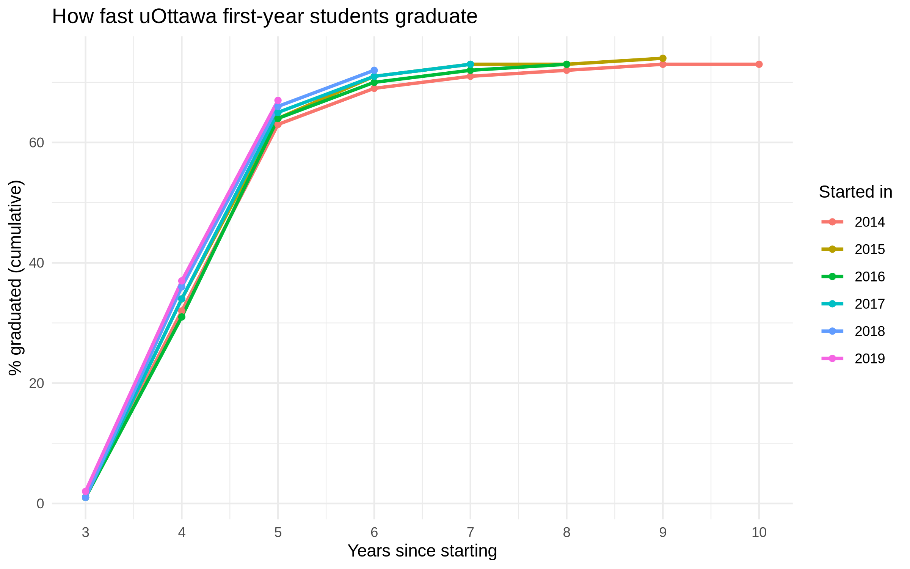
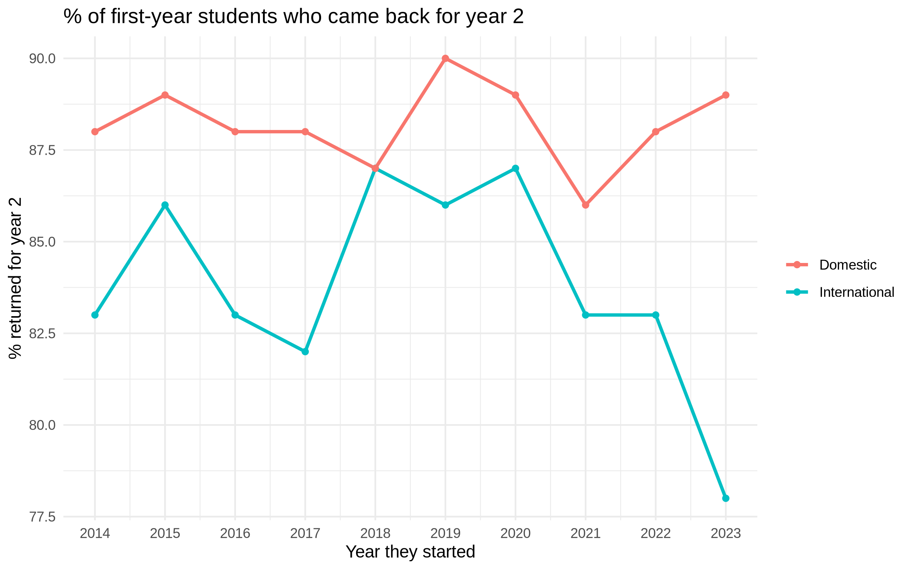

# uOttawa Student Success: Retention and Graduation Analysis (R)

International first-year students at the University of Ottawa have consistently lower odds of returning for year 2 than domestic students (odds ratio 0.70 across 2014–2023), and the gap reached 11 percentage points for the 2023 entering class (78% vs 89%). Women graduate within six years at higher rates than men (76% vs 66% for the 2018 class), and six-year graduation is improving by about 4% in odds per entering year.

All figures come from uOttawa's public retention and graduation report (first-year, first-time, full-time, bachelor's degree-seeking students; entering classes 2014–2023).

## Key findings

| Question | Result | Evidence |
|---|---|---|
| Do international students return for year 2 less often? | Yes, every year. Odds of returning are about 30% lower than for domestic students. | Logistic regression, all 10 classes: OR 0.70 (95% CI 0.65–0.74), p < 0.001; still significant with a quasibinomial model (p = 0.0003) |
| How large was the gap for the 2023 class? | 78.0% vs 89.0% returned; gap 8.3 to 13.7 points | Two-proportion test, p < 0.001 |
| Has overall year-2 return changed since 2014? | No clear trend | Logistic regression, OR 0.99 per year, p = 0.12 |
| Do women and men graduate at different rates? | Yes. 76.0% of women vs 66.0% of men graduated within 6 years (2018 class) | Two-proportion test, gap 7.5 to 12.5 points, p < 0.001 |
| Gender gap across all classes? | Women's odds of 6-year graduation are about 69% higher | Logistic regression, 2014–2018 classes: OR 1.69 (95% CI 1.60–1.78), p < 0.001 |
| Is graduation improving? | Yes, about 4% higher odds of 6-year graduation for each later class | OR 1.04 per year (95% CI 1.02–1.06), p < 0.001 |





## Data quality

Six checks run before any analysis (`R/02_check_data.R`):

1. International + domestic students = total, for every class. **Pass**
2. In-province + out-of-province high school students = total. **Pass**
3. Every percentage is between 0 and 100. **Pass**
4. Cumulative graduation never decreases over time. **Pass**
5. 7 groups × 10 entering classes = 70 rows. **Pass**
6. Female + male = total. **Failed at first.** From the 2017 class onward, 81–213 students per class are counted in the total but in neither the female nor the male group (213 in 2023). The rule was changed to "female + male ≤ total", and the gender comparisons exclude these students.

## Method

1. **Extract:** parse the PDF with `pdftools`; each data line starting with a year becomes a row (group, entering class, headcount, 18 rates).
2. **Check:** the six data-quality rules above.
3. **Describe:** cumulative graduation curves; year-2 return by domestic and international status.
4. **Test:** two-proportion tests (`prop.test`) on counts rebuilt from rates × headcount.
5. **Model:** binomial logistic regression (`glm`) on grouped counts with group and entering year as predictors. Because the year-2 model shows extra year-to-year variation (residual deviance 99.7 on 17 df), it is re-fit with a quasibinomial model as a robustness check.

## Limitations

- **Rounded rates:** the source rounds every rate to a whole percent, so rebuilt student counts are approximate (about ±0.5 points). This is far smaller than the gaps found.
- **Aggregate data only:** the report covers institution-wide groups. It cannot separate effects by faculty, program or student background, and the results show association, not cause.
- **Gender groups:** students not classed as female or male (from 2017) are excluded from gender comparisons.
- **Recent classes:** they have not yet reached later milestones, so 6-year graduation uses the 2014–2018 classes only.

## How to run

1. Install R and the packages: `install.packages(c("pdftools", "dplyr", "stringr", "tidyr", "ggplot2"))`
2. Put the two source PDFs in `data/raw/` (see Sources).
3. Open R in this folder and run `source("run_all.R")`.

```
data/raw/      source PDFs
data/clean/    retention.csv (created by step 2)
R/             01 read, 02 check, 03 charts, 04 tests, 05 regression
outputs/       charts
```

## Sources

- University of Ottawa, Institutional Research and Planning, *Retention and Graduation Statistics, First-year, First-time, Full-time, Baccalaureate Degree-Seeking Students, Institution-Wide Rates* (2023-24): https://www.uottawa.ca/about-us/sites/g/files/bhrskd336/files/2026-04/2023-24_Uottawa_CSRDE.pdf
- University of Ottawa, IRP Fact Book (degrees conferred, 2016–2025; included for a planned extension, not used in this analysis): https://www.uottawa.ca/about-us/sites/g/files/bhrskd336/files/2026-02/g_fact_book_-_uotta_-_2016_-_2025_-_en.pdf
- Fact book page: https://www.uottawa.ca/about-us/administration-services/institutional-research-planning/facts-figures/fact-book

Author: Tanima Garg
